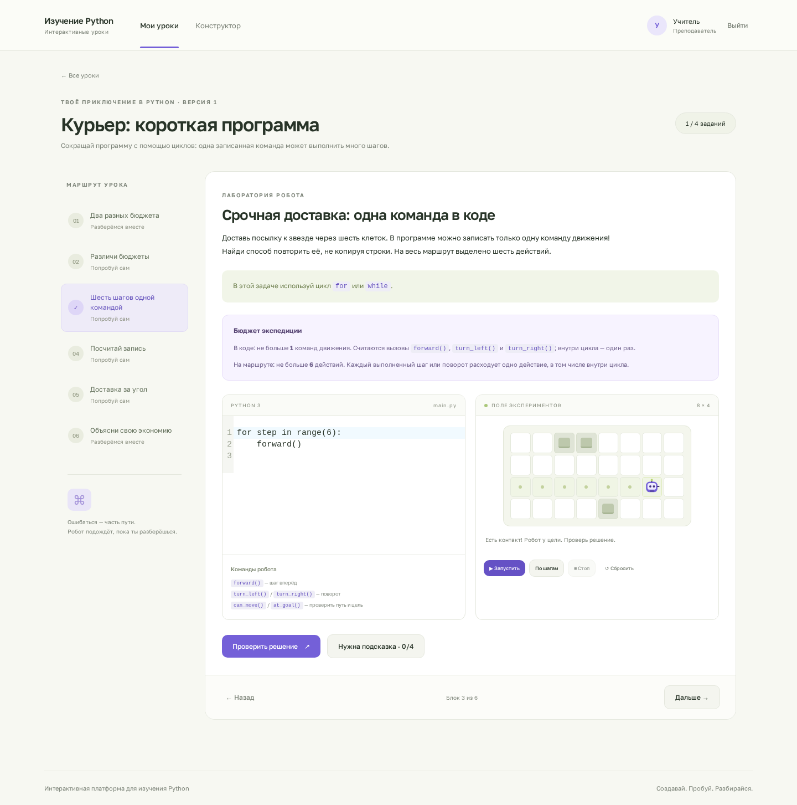
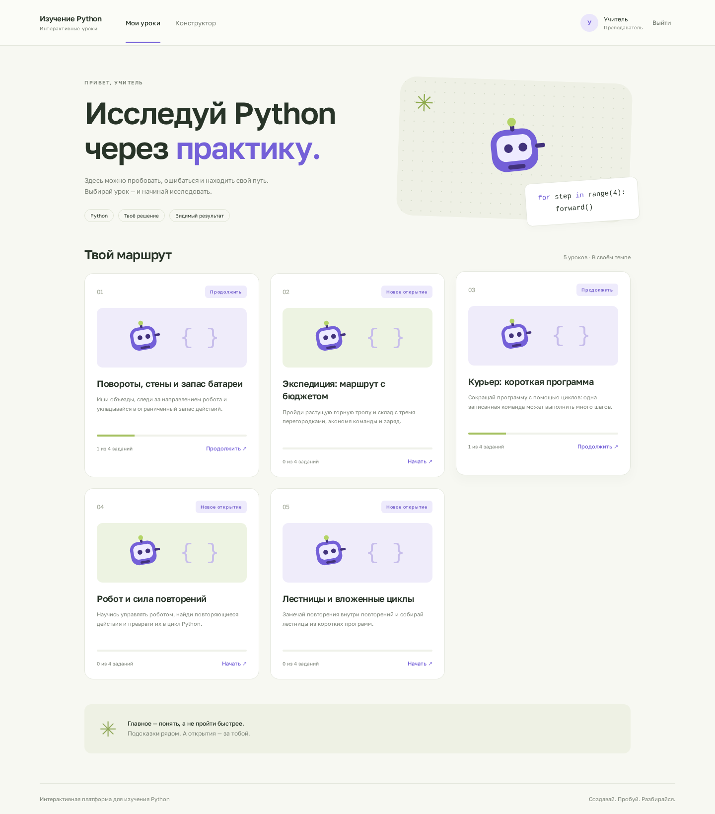
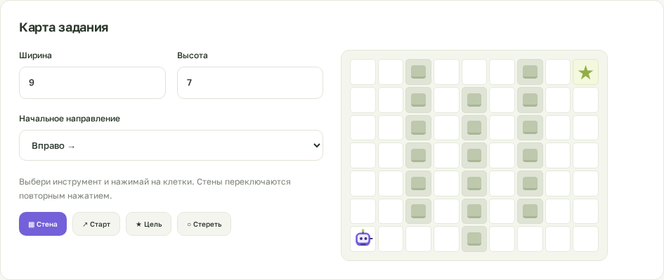

<div align="center">

<h1>Интерактивная платформа<br>для изучения Python</h1>

<p>Пиши код. Управляй роботом. Находи свой путь.</p>

<p>
  
  
  
  
  
  
</p>

<p>
  <a href="#preview">Скриншоты</a> ·
  <a href="#features">Возможности</a> ·
  <a href="#quick-start">Быстрый старт</a> ·
  <a href="docs/DEVELOPMENT.md">Разработка</a> ·
  <a href="docs/DEPLOYMENT.md">Развёртывание</a>
</p>

</div>



<p align="center"><sub>Настоящий интерфейс платформы: код, результат и обратная связь рядом.</sub></p>

## Учиться через действие

Образовательная платформа для детей 8–14 лет. Короткие объяснения чередуются
с экспериментами, тестами и задачами на Python: провести робота через препятствия,
найти повторения, сократить программу и уложиться в запас батареи.

Каждый урок проходит через небольшой цикл:

**Объяснение → эксперимент → задача → обратная связь → закрепление.**

Ученик сразу видит результат программы, пробует разные решения и открывает
подсказки по мере необходимости. Преподаватель видит попытки и использование
подсказок, чтобы понимать, где нужна поддержка.

<a id="features"></a>

## Возможности

| Для ученика | Для преподавателя |
| --- | --- |
| Редактор Python прямо в браузере | Конструктор уроков из отдельных блоков |
| Разделы уроков и фильтрация по тегам | Настройка разделов и тем без перепубликации |
| Построчное выполнение с подсветкой и движением робота | Разбор логики программы вместе с учеником |
| Робот на карте со стенами, стартом и целью | Визуальный редактор карт |
| Тесты, короткие ответы и практические задачи | Библиотека переиспользуемых заданий |
| Последовательные подсказки | Настройка правил, лимитов и подсказок |
| Личные черновики и сохранённые результаты | Создание учётных записей учеников |
| Личная панель прогресса и маленькие достижения | Подробный прогресс по урокам, заданиям и попыткам |
| Продолжение с незавершённого задания | Безопасная смена пароля ученика |
| Продолжение с другого устройства | Просмотр попыток и самостоятельности решения |

Уроки и задания хранятся в БД. Преподаватель собирает новый учебный маршрут
через интерфейс. Публикация создаёт отдельную версию: изменение черновика
сохраняет историю прежних попыток.

<a id="preview"></a>

## Как это выглядит

<details>
<summary><strong>Каталог уроков и индивидуальный прогресс</strong></summary>

У каждого ученика — собственные результаты, черновики и выполненные задания.



</details>

<details>
<summary><strong>Конструктор и визуальный редактор карты</strong></summary>

Выбирайте старт, цель, препятствия и направление робота нажатием на клетки.
Добавляйте условие, начальный код, ограничения и подсказки.



</details>

## Пять готовых уроков

В комплекте **5 уроков и 20 заданий**. Программа начинается с отдельных команд
и постепенно переходит к маршрутам с препятствиями, вложенным циклам и переменной
длине участка. Определение собственных функций в этих уроках не требуется.

Все пять уроков находятся в разделе «Циклы», а теги уточняют тему: `for`,
`range`, вложенные циклы, планирование маршрута и ограничения команд.

| Урок | Что исследуем |
| --- | --- |
| Робот и сила повторений | Команды, первый цикл, предсказание результата |
| Курьер: короткая программа | Поиск повторений и экономия команд в коде |
| Повороты, стены и запас батареи | Направление, объезды и стоимость маршрута |
| Лестницы и вложенные циклы | Повторяющиеся группы действий и отступы |
| Экспедиция: маршрут с бюджетом | Растущие участки и путь через три перегородки |

Контент поставляется отдельными JSON-файлами:
[первый урок](backend/content/robot-introduction.json) и
[четыре испытания](backend/content/robot-challenges.json).

### Два бюджета — две задачи на мышление

```python
for step in range(6):
    forward()
```

В тексте этой программы **одна команда движения**, а при выполнении — **шесть
действий**. Цикл сокращает запись; короткий маршрут экономит заряд.
Команды робота доступны сразу: подключать модуль в ученическом коде не требуется.

- `max_code_commands` — число записанных вызовов команд движения. Комментарии,
  пустые строки и `range()` не учитываются.
- `max_commands` — все выполненные шаги и повороты, включая повторения цикла.

Оба ограничения видны ученику и настраиваются преподавателем.

<a id="quick-start"></a>

## Быстрый старт

Нужен Docker с Compose. При первом запуске скопируйте пример настроек:

```bash
cp .env.example .env
docker compose up --build -d
```

Создайте преподавателя — команда запросит пароль скрытым вводом:

```bash
docker compose exec backend uv run --no-sync manage.py create_teacher teacher
```

Импортируйте готовые уроки:

```bash
docker compose exec backend uv run --no-sync manage.py import_lessons content/robot-introduction.json --owner teacher --publish
docker compose exec backend uv run --no-sync manage.py import_lessons content/robot-challenges.json --owner teacher --publish
```

Откройте **[http://127.0.0.1:5173](http://127.0.0.1:5173)**, войдите под созданной
учётной записью и добавьте учеников на вкладке **Конструктор → Ученики**.

> Повторный импорт добавляет новые уроки. Выполните команды импорта один раз
> для новой базы. Обычные изменения контента делаются через конструктор.

Запуск без Docker через `uv` описан в [руководстве разработчика](docs/DEVELOPMENT.md).
Для сервера есть отдельная [инструкция развёртывания](docs/DEPLOYMENT.md).

## Стек

| Слой | Технологии |
| --- | --- |
| Сервер | Python, Django, Django REST Framework |
| Данные | PostgreSQL; SQLite для локального запуска без Docker |
| Интерфейс | React, TypeScript, Vite, Lucide Icons |
| Редактор | CodeMirror 6 |
| Выполнение Python | Skulpt в отдельном Worker внутри sandboxed iframe |
| Авторизация | Серверные сессии, HttpOnly cookies, CSRF-защита |
| Зависимости | `uv` + `uv.lock`, npm + `package-lock.json` |
| Серверный запуск | Docker Compose, Nginx, Gunicorn |
| Проверки | unittest / pytest, Playwright, проверка программ в Skulpt |

## Документация

- [Разработка и тестирование](docs/DEVELOPMENT.md) — локальное окружение, команды проверок и структура проекта.
- [Развёртывание](docs/DEPLOYMENT.md) — серверный Compose, порты, настройки и импорт уроков.
- [Модель контента](docs/CONTENT_MODEL.md) — объекты уроков, правила проверки и формат JSON.
- [План проекта](PROJECT_PLAN.md) — педагогический подход, границы MVP и дальнейшее развитие.

### Статус MVP

Реализованы обучение с роботом, конструктор, тесты, подсказки и индивидуальный
прогресс. Следующие этапы — Turtle, назначение уроков отдельным ученикам
и восстановление пароля. Сейчас все опубликованные уроки доступны вошедшим
пользователям.

Skulpt поддерживает ограниченный набор Python и загружается с CDN. Проверка
маршрута опирается на команды браузерного запуска; она подходит для учебной
обратной связи. Подробности и границы проверки описаны в
[документации разработчика](docs/DEVELOPMENT.md#execution).
