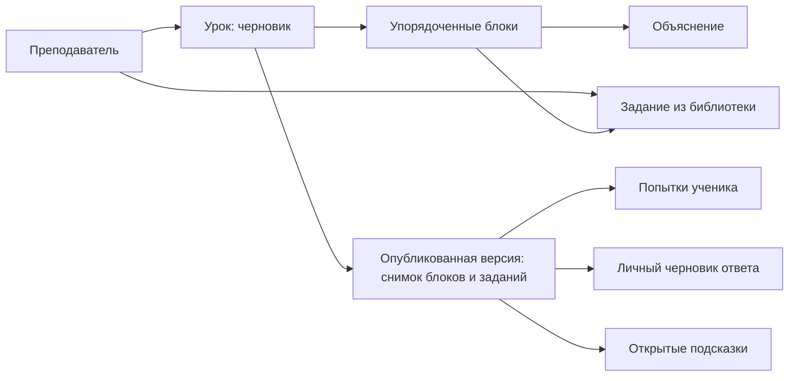

# Контент как объекты

Содержимое уроков хранится в БД. Интерфейс знает, как показать тип блока
и выполнить тип задания; конкретные тексты, карты и ответы приходят из API.
Создание очередного урока не требует изменения React-компонентов.

## Связи



- **Exercise**: независимое, повторно используемое задание. Тип, заголовок,
  условие, начальный код, публичная конфигурация, закрытые правила и подсказки.
- **Lesson**: редактируемый сценарий с названием и описанием.
- **LessonBlock**: отдельная запись с UUID, порядком, типом и содержимым.
  Текстовый блок содержит объяснение; блок задания ссылается на Exercise.
- **LessonRelease**: отдельная опубликованная версия со снимком содержимого.
  Снимок содержит и условия, и правила конкретной публикации. API ученика
  выдаёт только белый список публичных полей.
- **Attempt / Draft / HintUsage**: пользователь + версия урока + UUID блока.
  Поэтому два включения одного задания в урок считаются отдельными упражнениями.

В первой реализации преподаватель не вводит JSON для повседневной работы:
есть формы для заданий и блоков, редактор карты и кнопки изменения порядка.
JSON нужен для переноса, пакетной подготовки и импорта контента.

## Поддерживаемые типы

| Тип | Конфигурация | Закрытые правила | Проверка |
| --- | --- | --- | --- |
| `quiz` | choices, multiple | correct_options | Совпадение множества выбранных вариантов |
| `short_answer` | пустой объект | answers, case_sensitive | Сравнение нормализованного ответа |
| `robot` | width, height, start, goal, walls | require_loop, max_commands | Воспроизведение команд и проверка цели; AST для требования цикла |

Робот — первая интерактивная среда. Добавление Turtle потребует нового типа
проверки и renderer-компонента, но не изменения структуры уже созданных уроков.
Мы не вводим произвольный JavaScript в контент: новые исполняемые типы подключает
разработчик, преподаватель настраивает доступные параметры.

## Формат файла импорта

```json
{
  "schema_version": 1,
  "exercises": [
    {
      "key": "four-steps",
      "title": "Четыре шага до звезды",
      "kind": "robot",
      "prompt": "Доведи робота до цели с помощью цикла.",
      "starter_code": "from robot import *\n\n",
      "config": {
        "width": 6,
        "height": 4,
        "start": {"x": 0, "y": 2, "direction": "east"},
        "goal": [4, 2],
        "walls": []
      },
      "rules": {"require_loop": true},
      "hints": ["Сколько одинаковых шагов нужно сделать?"]
    }
  ],
  "lessons": [
    {
      "title": "Знакомство с циклами",
      "summary": "Учимся замечать повторения.",
      "blocks": [
        {"kind": "text", "title": "Повторяющиеся действия", "body": "Цикл повторяет команды."},
        {"kind": "exercise", "title": "Попробуй сам", "exercise_key": "four-steps"}
      ]
    }
  ]
}
```

Координаты начинаются с нуля: x растёт вправо, y — вниз. Направления:
`north`, `east`, `south`, `west`. Карты от 2×2 до 12×12; старт и цель
должны отличаться, не попадать на стены и соединяться доступным путём.

Импорт атомарный: если один объект не прошёл проверку, импорт целиком откатывается.
Повторный импорт добавляет новые черновики. Обновление существующих объектов по
внешним ключам пока не реализовано, чтобы импорт не перезаписывал авторские изменения.

## Публикация и история

Сохранение урока меняет его черновик. Публикация создаёт новую версию и копирует
в неё определения всех используемых заданий. Изменения библиотеки не затрагивают
снимки прежних публикаций. Попытки и подсказки остаются связаны с исходной версией.

Публичный API возвращает только опубликованные версии, а авторский API — только
объекты текущего преподавателя. Идентификатор ученика всегда берётся из сессии.
Проверки ответов и тексты неоткрытых подсказок не входят в ученический API.

Снимки недоступны для редактирования через API и Django admin; обычный `save()`
существующего снимка также запрещён. Это ограничение прикладного уровня:
прямой SQL или `QuerySet.update()` могут его обойти. При необходимости строгого
аудита следует дополнительно ограничить права БД или использовать триггеры.

## Реализация

- `backend/learning/models.py` — сущности и ограничения БД.
- `backend/learning/domain.py` — схемы контента, выдача публичных полей и проверки.
- `backend/learning/services.py` — создание опубликованного снимка.
- `backend/learning/serializers.py` — сборка и редактирование уроков через API.
- `frontend/src/Author.tsx` — библиотека, редактор карты и конструктор.
- `frontend/src/LessonPlayer.tsx` — отображение блоков из опубликованных данных.
